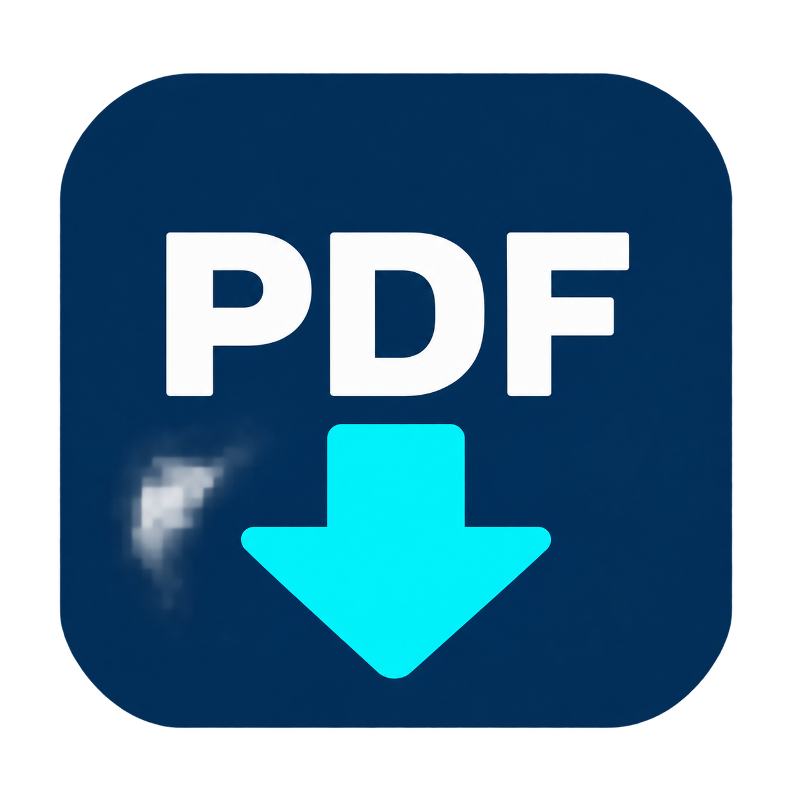

<p align="center"></p>

# TOPDF

**모든 문서를 읽는 앱 — 현재 5가지 문서 형식 지원**

[](https://github.com/withoz/topdf/actions/workflows/build.yml)

문서를 끌어놓으면 PDF로 변환해 앱 안에서 바로 보는 Windows 데스크톱 앱입니다. 현재는 **한글·워드·엑셀·DWG·DXF**를 지원하는 개발 버전이며, 모든 확장자나 원본과 완전히 동일한 출력을 보장하지 않습니다.

| 현재 지원하는 5가지 | 확장자 | 기본 변환 엔진 |
|---|---|---|
| 한글 | HWP, HWPX | rhwp |
| 워드 | DOCX | office2pdf |
| 엑셀 | XLS, XLSX | 수정 Ream / MiniPdf |
| DWG 도면 | DWG | LibreDWG → ezdxf |
| DXF 도면 | DXF | ezdxf / matplotlib |

기존 PDF는 변환 없이 바로 볼 수 있습니다. HWPX는 변환 경로를 지원하며 다른 형식과 마찬가지로 폭넓은 실제 문서 검증이 더 필요합니다. DOC, PPT/PPTX, ODT 등은 현재 별도로 선택하는 설치형 호환 모드 대상입니다.

## 주요 기능

- [PDF 수정](docs/PDF-EDITING.md): 작은 아이콘 리본에서 도구 선택으로 바로 편집, Esc로 보기 복귀(수정 상태 유지), 기존 본문 선택·교체, 글자·메모·이미지 도장·도형·자유곡선·검토 표시, 여러 항목 편집, 페이지 변경, PDF 및 `.topdf` 편집 파일 저장

- 스마트 패널: 변환 품질 점검, 한국어·영어 OCR, 열린 문서 검색, 문장 비교, 로컬 AI 근거 답변, 폴더 자동 변환
- 내장 경량 로컬 AI 모델 포함. 문서는 외부 AI 서비스에 전송하지 않습니다.
- 파일 추가·드래그앤드롭 즉시 자동 변환, 변환 중 추가 파일도 순차 처리, 취소·재시도
- 작은 문서 탭으로 전환·닫기, 같은 파일 중복 열기 방지
- PDF 미리보기, 확대·페이지 이동·검색·인쇄
- 창 전체 미리보기, 메뉴 버튼으로 파일 목록·기능 표시, F11 전체 화면
- 체크박스 선택 저장, 전체 선택·해제, 같은 이름 충돌 시 번호 추가
- 탐색기 연결 프로그램 등록과 파일 열기 시 자동 변환
- XLS 병합 셀 금액이 지나치게 작아지는 오류 보완
- 기본 모드에서 한글·Microsoft Office·LibreOffice·AutoCAD·ODA 프로그램 호출 없음

기본 모드도 .NET, WebView2 및 CAD용 Python 런타임은 필요합니다. 로컬 시험용 설치 파일 제작 스크립트를 제공합니다. .NET과 CAD용 Python을 포함하며, WebView2가 없는 PC에서는 최초 설치에 인터넷이 필요합니다. 바이너리 공개 릴리스 전 코드 서명·깨끗한 PC 검증·전체 라이선스 검토가 남아 있습니다. [설치판 안내](docs/INSTALLER.md)를 참고하세요.

## 빌드 및 실행

Windows 10/11 x64, .NET 10 SDK, Node.js 20 이상과 Rust/MSVC 빌드 도구(엔진 빌드 때만), Python 3.11 이상(CAD), Microsoft Edge WebView2 Runtime이 필요합니다.

```powershell
git clone https://github.com/withoz/topdf.git
cd topdf
pwsh -File scripts/Setup-Engines.ps1
# OCR·로컬 AI 포함 빌드는 다음 단계도 실행 (모델 약 491MB)
pwsh -File scripts/Setup-SmartEngines.ps1
python -m venv .venv
.\.venv\Scripts\python.exe -m pip install -r src/Topdf/engines/requirements.txt
$env:TOPDF_PYTHON = (Resolve-Path .venv/Scripts/python.exe).Path
dotnet build src/Topdf/Topdf.csproj -o artifacts/app
.\artifacts\app\Topdf.exe
```

`Setup-Engines.ps1`은 고정 버전 공식 엔진을 프로젝트 안으로 다운로드하고 SHA-256을 확인한 뒤 HWP 레이아웃 보정 패치와 XLS용 JavaScript 번들을 빌드합니다. HWP는 고정된 upstream 소스와 패치 해시로 재현하며, 설치 사용자에게 Rust/MSVC 설치는 필요하지 않습니다. [HWP 레이아웃 보정](docs/HWP-LAYOUT-FIX.md)을 참고하세요. 시스템 기본 앱이나 레지스트리는 변경하지 않습니다. Node는 XLS 런타임에 사용하지 않습니다.

빌드만 확인하려면 `-SkipNative` 옵션으로 네이티브 엔진 다운로드를 생략할 수 있습니다. 이 경우 해당 엔진의 실제 변환은 동작하지 않습니다. [개발 안내](docs/DEVELOPMENT.md)를 참고하세요.

## 사용법

0.3.0의 새 기능은 상단 **스마트** 버튼에서 엽니다. [스마트 기능 사용법·검증·제한](docs/SMART-FEATURES.md)을 확인하세요. 로컬 AI 모델 포함으로 설치 파일 크기가 커졌습니다.

1. 왼쪽 위 **메뉴 → 파일 추가**로 파일을 선택하거나 창에 끌어놓습니다. 자동으로 변환하고 PDF는 바로 표시합니다.
2. 상단 탭으로 문서를 바꾸고 ×로 닫습니다. 메뉴에서 완료된 파일을 클릭해도 PDF가 표시됩니다. 실패·취소된 문서는 **재시도**할 수 있습니다.
3. 저장할 때는 메뉴를 열고 행을 체크한 뒤 **선택 저장**에서 폴더를 선택합니다. 체크박스 선택 중에는 메뉴를 유지합니다.
4. 탐색기에서 쓰려면 메뉴의 **더보기 → 연결 프로그램 등록**을 누른 뒤 파일 우클릭 → 연결 프로그램 → TOPDF를 선택합니다.

`Ctrl+M`으로 메뉴를 열고 닫으며 `Esc`로 메뉴를 닫을 수 있습니다. `F11`은 화면 전체 보기/창 모드 전환입니다.

기본 연결 앱은 자동으로 바꾸지 않습니다. 설치형 호환 모드는 사용자가 체크한 경우에만 기존 프로그램을 사용합니다.

## 정확도와 제한

- 실제 검증한 문서 묶음에서는 6개 파일(HWP/DOCX/XLS/XLSX/DWG/DXF)의 변환·내부 미리보기를 확인했습니다. 고객 문서와 결과는 저장소에 포함하지 않습니다.
- 글꼴·줄바꿈·행 높이·테두리 배치는 원본 프로그램 출력과 다를 수 있습니다.
- CAD는 A3 가로 전체 맞춤의 **2D 미리보기**입니다. 정밀 축척, 3D, 전문 객체, XREF, CTB/STB는 별도 검증 대상입니다.
- 일부 CAD 텍스트는 윤곽으로 출력되어 검색·복사가 불가능합니다.
- 암호·손상·대용량 문서와 모든 문서 객체를 보장하지 않습니다.
- 임시 입력 복사본·PDF·엔진 로그와 WebView2 데이터는 `%LOCALAPPDATA%\TOPDF`에 남습니다. 자동 만료·앱 내 삭제는 후속 과제입니다.
- XLSX 수식은 저장된 계산 결과를 표시하며, 계산 결과가 없으면 빈 금액 출력 대신 변환을 중단합니다. 자체 수식 재계산은 지원하지 않습니다.
- 한글 렌더링에는 Windows 글꼴을 사용합니다. 이 저장소는 독점 글꼴을 포함하지 않습니다.

## 검증 및 개선

```powershell
dotnet run --project tests/ExportSmoke/ExportSmoke.csproj
dotnet build tests/PreviewSmoke/PreviewSmoke.csproj
# Windows 데스크톱 세션의 UI 검사
dotnet run --project tests/PreviewSmoke/PreviewSmoke.csproj -- --export-ui
```

[0.2.0 실제·합성 회귀 검증](docs/VALIDATION-0.2.0.md)에 자동 변환·탭·금액·오류 입력 시험을 정리했습니다.

우선 보강 항목과 근거는 [개선 계획](docs/IMPROVEMENTS.md)에 정리했습니다. 이슈에는 실제 업무 문서를 첨부하지 말고 비식별 재현 파일과 환경·엔진 버전을 제공해 주세요.

## 라이선스

TOPDF 자체 코드와 로고는 [MIT](LICENSE)로 공개합니다. 외부 엔진과 의존성에는 각자의 라이선스가 적용됩니다. **전체 배포물을 단일 MIT 라이선스로 해석하면 안 됩니다.** LibreDWG는 GPL-3.0-or-later입니다.

이 저장소는 외부 엔진 바이너리·글꼴·개인 문서·생성 결과를 배포하지 않습니다. 자세한 내용은 [외부 구성 요소](docs/THIRD_PARTY.md)를 확인하세요.
